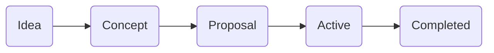

# Design Projects

A system to organize and communicate active design projects on Monocle Network. It should make it easy for someone to quickly glance at active projects and participate in one of interest without wading through irrelevant discussion. The system should also be as open as possible, allowing anyone to formulate an idea, turn it into a concept, then a proposal, and begin working on it.

This document is about larger contributions that may involve multiple contributors over days, weeks, and months. Smaller requests and improvements (fixing typos, updating an image, bugs) can more simply get handled via issues.

## Project life cycle

Many projects start as simple ideas and grow over time with the help of different people. Ideas can be about the application, the markets site, the website, the wiki, brand assets, and more.

### 1. Idea

- Formulate the idea and discuss it in Monocle community spaces (SimpleX, Matrix, GitHub Discussions) to get feedback
- References, prototypes, sketches, and other materials that help explain the idea are great for communicating clearly
- An idea does not have to be so specific that the outcome is clear

### 2. Concept

- A more mature idea can be posted as an issue on GitHub (in the most appropriate repository and project board) after some discussion
- The concept can be fleshed out further in the comment thread of the issue
- The issue becomes the central place for the concept (unlike chat, where things get lost in the feed)

### 3. Proposal

- The goal of a proposal is to decide what to practically do about it, turning a concept into a plan
- Anybody can turn a concept into a proposal if they feel it is worthwhile to continue with it

### 4. Active project

- A proposal becomes an active project once there is enough support and people actively start working on it
- If the project is related to code or content on GitHub, a branch or fork can be created for the work to be executed
- If needed, a new repository and/or project board can be set up

### 5. Completed project

- If the project is in a branch or fork, a pull request is created
- This pull request needs to be reviewed
    - Support and concerns are shown via comments that contain an approval term (ACK, thumbs up, etc.) or disapproval term (NACK, thumbs down, etc.) and a rationale
    - Comments are primarily weighted based on the strength of the rationale, but may also be weighted based on expertise, commitment, and consistency of the commenter to the project
    - Concerns need to be adequately addressed (note this is different than resolved) by participants before moving forward
- A rough consensus should be reached before continuing
    - For a thoughtful explanation of rough consensus, please [read this](https://tools.ietf.org/html/rfc7282)
- On completion, the pull request is merged and closed, along with the issue

## Project ideas

A few ideas of things to try or get involved in. This is in no way comprehensive:

- Application UI audit and style guide - review the current application interface and establish a consistent visual language for future changes
- Onboarding flow - design the first-run experience for new peers, from download to first trade
- Markets site design - the clearnet offer book interface, including empty states, loading, and mobile considerations
- Website review pass - an accessibility and clarity review of monoclenetwork.org
- Wiki illustrations - diagrams for the Network Architecture and Trade Protocol pages
- Presentation templates - a reusable slide deck for community presentations and talks
- Social media templates - post graphics and banners in line with the brand guidelines
- Icon set - a consistent set of Monocle Network icons for use across the wiki and website
- Empty state and error message copy - a unified voice for application messaging
- Dark/light theme audit - consistency across the application and markets site

---

*Adapted from the Bitcoin Design Community project process, [CC BY 4.0](https://bitcoin.design/).*
